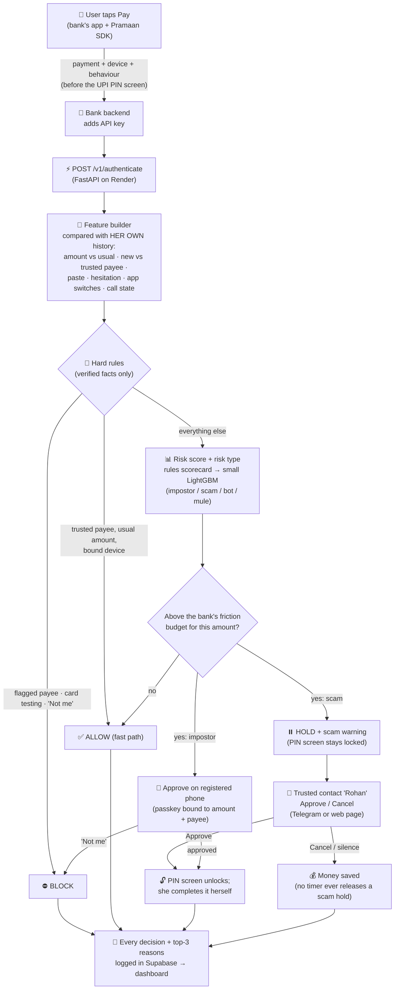

# 🛡️ Pramaan (प्रमाण, "proof")
**Caffeinated Nerds · BIOS Hackathon finals (Thapar) · Frontier mode · PS-04: Fast and Secure Online Transaction Authentication**

> ## 🚀 New teammate? Paste this into Claude (opened in the folder where you want the project):
> ```
> Read https://raw.githubusercontent.com/bhavyammisra/Pramaan/main/SETUP.md and follow it to set me up on this repo.
> ```
> **🤖 Claude:** if you were asked to set someone up, follow [`SETUP.md`](SETUP.md). Otherwise read [`PLAN.md`](PLAN.md) first: it is the whole plan in one page and wins over any older doc.

## The problem in one line
**A PIN checks *who* you are. Nobody checks *what's happening*.**
Asha, 72, is on a video call with a fake "CBI officer". On her own phone, at home, she types her own UPI PIN. Every check passes, and ₹85,000 goes to a scammer. Most fraud in India now works like this: RBI calls account takeover "now negligible", and victims pay the scammer themselves. OTPs can't stop that, and refunds won't save her (RBI's compensation only covers losses up to ₹50,000).

## What Pramaan does
A risk service the bank calls **when the user taps Pay, before the UPI PIN screen**. In milliseconds it returns **allow / challenge / block** plus the **top 3 reasons in plain language**. It sits on top of mandated 2FA and never replaces it.

**One principle: money is untrusted until it's proven safe, and the challenge must fit the danger.**

| What we see | Likely risk | Pramaan's response |
|---|---|---|
| Usual payee, own phone, usual amount | none | ✅ **Allow** instantly |
| New phone, SIM changed yesterday | Impostor | 📱 Approve on the owner's **registered phone** (bound to this exact payment), or "Not me" → block |
| Own phone, on a call, pasted a new UPI ID, 71× her usual amount | **Coached victim** | ⏸️ **Hold** + scam warning; only her **trusted contact** (or the bank) can release it |
| Payee on a fraud list, bot-like velocity | Fraud for sure | ⛔ **Block** |

**Google warns. RBI's proposed rule holds every first-time ₹10k+ transfer. Pramaan holds only the risky payment, says why, and asks the right person.**

## The pipeline



**Safety rules built into the pipeline**
- Signals reported by the phone can only **raise** risk, never lower it (a scammer can fake a "clean" phone).
- Only verified facts can **block**; the model can only **challenge**.
- New payees stay **on probation for 30 days**, so repeat investment-scam payments never become "normal".
- If Pramaan is down, the bank falls back to normal 2FA plus its RBI-style hold: **never weaker than today**.

Example response:
```json
{ "decision": "challenge", "risk_type": "SCAM",
  "challenge": { "type": "trusted_contact" },
  "reasons": [ "You're on a phone call while sending money",
               "Amount is 71× your usual ₹1,200",
               "First payment to this receiver" ] }
```

## Stack (₹0 running cost)
Python + FastAPI + LightGBM on **Render** (free) · React (Vite) demo app + dashboard on **Vercel** · **Supabase** Postgres for decisions, holds and contacts · **Telegram Bot API** for the trusted-contact loop · **WebAuthn passkeys** for the registered-phone approval. No paid APIs.

## What's real vs simulated in the demo
Pasted UPI ID, hesitation, app switches, time to pay, amount, payee history and velocity are **REAL**. Call state is real only if our Android test passes; screen-sharing and SIM change are **SIMULATED** (labelled on screen). They come from a bank's mobile SDK in production.

## Where things are
| Read | For |
|---|---|
| [`PLAN.md`](PLAN.md) | **The whole plan in one page** (start here) |
| [`docs/04-plan/roadmap.md`](docs/04-plan/roadmap.md) | What we do, in order, from 29 Oct to judging |
| [`STATUS.md`](STATUS.md) | Live project state |
| [`docs/00-index.md`](docs/00-index.md) | Every doc, one line each |
| [`docs/03-design/`](docs/03-design/) | Risk engine, threat model, API, architecture, decisions |
| [`docs/05-pitch/README.md`](docs/05-pitch/README.md) | Demo script + judge Q&A |
| [`CONTRIBUTING.md`](CONTRIBUTING.md) | How we work with git |
| [`src/`](src/README.md) | Code (built during the hack) |

## Quickstart
_Filled in during the hack, once the code exists._

## Team
Bhavyam Misra · Gunagye Jain · Abhijay Nagal · Shefali Sharma ([`docs/04-plan/team.md`](docs/04-plan/team.md)). Roles: to be decided.
